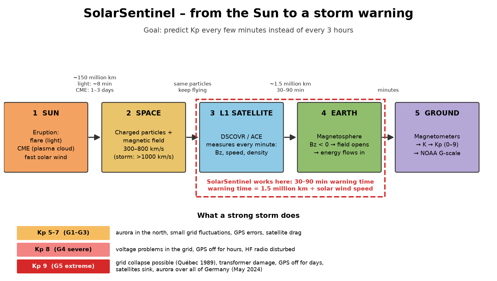

# SolarSentinel

Live forecasting of geomagnetic storms (Kp index) from solar wind data.



## Goal

| | |
|---|---|
| Problem | The official Kp index is only updated every **3 hours**. |
| Goal | A forecast every **few minutes** from real-time data. |
| Target | **Kp index** (0–9): how disturbed Earth's magnetic field is. From Kp 5 on it is a storm (G1–G5). |
| Idea | Satellites at L1 measure the solar wind 30–90 minutes before it reaches Earth. Above all Bz < 0 (magnetic field pointing south) drives storms. |

New to the topic? Start with [Karl/00_project_explained.ipynb](Karl/00_project_explained.ipynb) and the [glossary](Karl/glossary.md).

## Data

Source: NASA OMNI ([spdf.gsfc.nasa.gov/pub/data/omni](https://spdf.gsfc.nasa.gov/pub/data/omni))

| Dataset | Resolution | Period | Key columns |
|---|---|---|---|
| OMNI2 | hourly | since 1963 | `kp`, `dst`, `ap`, `f107`, `sunspot` |
| OMNI high-res | 1 minute | since 1981 | `bz_gsm`, `by_gsm`, `b_mag`, `speed`, `density`, `pressure`, `e_field`, `sym_h`, `ae` |

NASA fill values (e.g. `9999.99`) become `NaN` when loading.

## Setup

Requirement: [uv](https://docs.astral.sh/uv/getting-started/installation/). uv downloads Python 3.14 itself if it is missing.

```bash
git clone https://github.com/alexandervonwernherr/SolarSentinel.git
cd SolarSentinel
uv sync                              # builds .venv exactly from uv.lock
uv run nbdime config-git --enable    # once: readable notebook merges
```

In notebooks choose `.venv` as kernel.

| File | Content | In the repo? |
|---|---|---|
| `.python-version` | Python version (3.14) | yes |
| `pyproject.toml` | packages: `dependencies` = model + dashboard, `dev` = notebooks/plots | yes |
| `uv.lock` | exact versions of all packages | yes |
| `.venv/` | the installed environment | **no**, everyone builds it |

Rules:
- New package: `uv add package` (development only: `uv add --dev package`), **never** `pip install`
- Always commit `uv.lock`
- After every `git pull`: `uv sync`

## Usage

1. Download and merge the data (several GB, takes long; files already downloaded are skipped):

   ```bash
   uv run python update_data.py
   ```

   Result: `omni_raw/` (raw NASA files) and `omni_all.csv` (merged table).

2. Open `SolarSentinel.ipynb`: converts `omni_all.csv` into `omni_1995.parquet`, builds features (e.g. `b_sum`) and trains a baseline (DummyRegressor vs. LightGBM).

3. Live Kp dashboard:

   ```bash
   uv run streamlit run Karl/tools/kp_dashboard.py
   ```

Data (`omni_raw/`, `*.csv`, `*.parquet`, `_data/`) and models (`_models/`) do **not** go into the repo (see `.gitignore`).

## Project structure

```
SolarSentinel/
├── update_data.py                 # OMNI download + merge
├── SolarSentinel.ipynb            # shared notebook: EDA + baseline
├── SolarSentinel_cronos.ipynb     # Chronos time-series model
├── SolarSentinel_patchTsT.ipynb   # PatchTST time-series model
├── _data/                         # local data (not in the repo)
├── _models/                       # saved models (not in the repo)
├── pyproject.toml, uv.lock        # packages (uv)
├── .python-version                # Python 3.14
├── Alex/  Nooshin/                # personal work folders
├── Karl/
│   ├── 00_project_explained.ipynb # the whole project explained, with live data
│   ├── glossary.md                # all technical terms
│   ├── project_sketch.png         # Sun → L1 → Earth → impacts
│   ├── tools/                     # Kp dashboard, OMNI-year-to-Parquet, sketch script
│   └── _temp/                     # old drafts, no longer needed
└── *.pdf, solarsentinel.qea       # plan and architecture
```

## Team

| Name | Role |
|---|---|
| Alex | GitHub, code |
| Karl | Project documentation |
| Nooshin | Science behind it |

## Notebook merge conflicts

```bash
nbdime mergetool
git add <notebook>.ipynb
git commit -m "Resolve notebook merge conflict"
```
